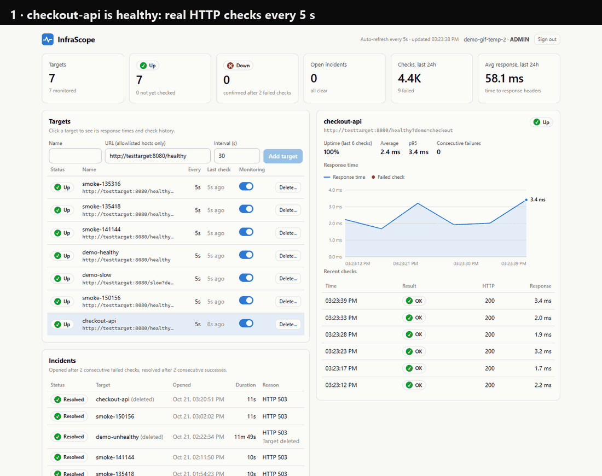
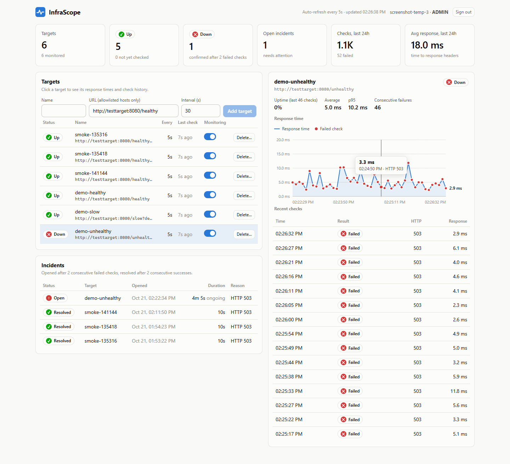
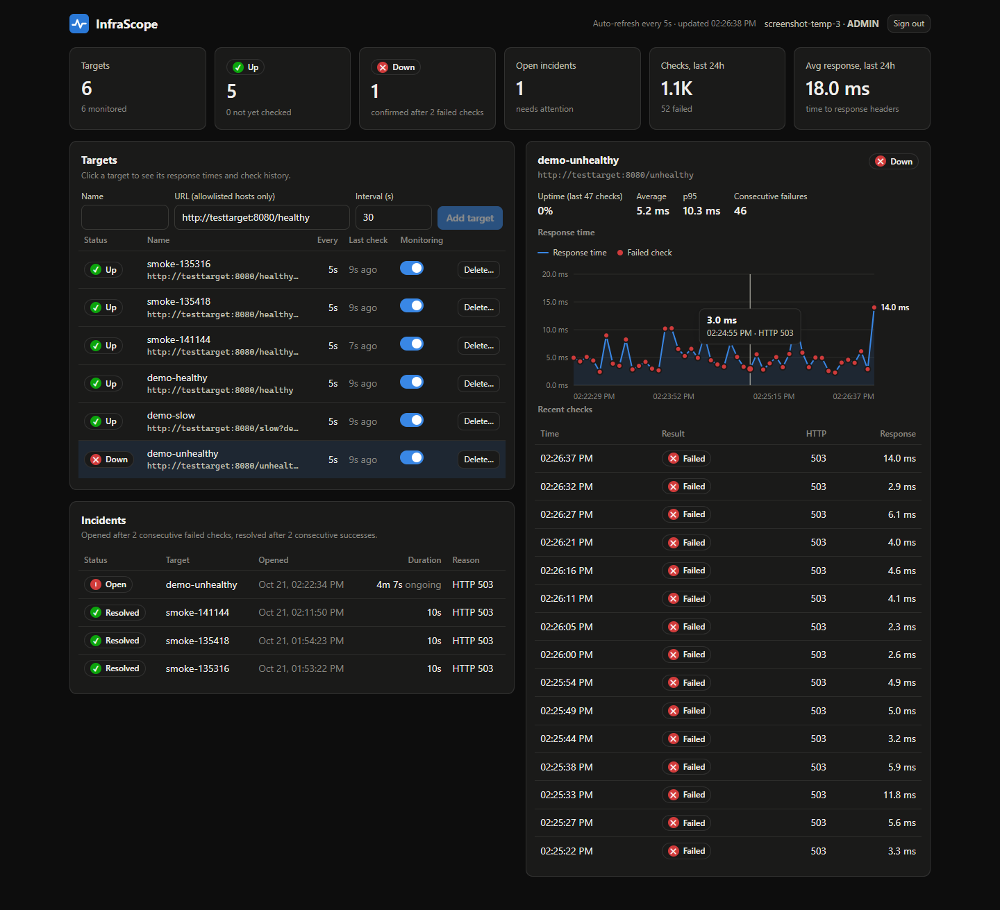
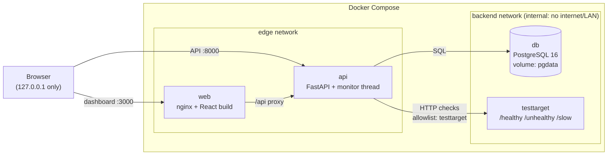

# InfraScope

[](https://github.com/PiggyDan/infrascope/actions/workflows/ci.yml)


Open-source infrastructure monitoring and incident detection. InfraScope checks HTTP(S)
endpoints on a schedule, stores every real measurement in PostgreSQL, and opens and
resolves incidents automatically.

> **Status:** monitoring backend, API-key authentication and a web dashboard.
> Progress logs: [Day 1](docs/DAY1_PROGRESS.md) · [Day 2](docs/DAY2_PROGRESS.md).



<details>
<summary>Screenshots (light and dark mode)</summary>




</details>

## Features

- Target management REST API (create, list, get, update, enable/disable, delete)
- Background HTTP monitor: real response times, status codes, timeouts and connection errors
- Incident detection: DOWN after 2 consecutive failures, resolved after 2 consecutive successes,
  no duplicate open incidents (enforced by a database index), history preserved
- PostgreSQL 16 with Alembic migrations, UUID keys, UTC timestamps
- SSRF protection: only allowlisted hostnames; no IPs, credentials or redirects
- API-key authentication with `VIEWER` / `ADMIN` roles; keys stored as SHA-256 hashes, shown once
- Web dashboard (React + TypeScript): live summary, targets (add / pause / delete for ADMIN),
  response-time chart with hover/keyboard readout, check history, incidents. Light and dark
  mode, works at phone width
- Docker Compose stack: API, PostgreSQL, the dashboard (nginx) and a local test-target service
- 141 pytest tests, incl. integration tests against the real test-target service and a check
  that every non-public route requires a key



More detail: [docs/ARCHITECTURE.md](docs/ARCHITECTURE.md) · API reference: [docs/API.md](docs/API.md)
· Interactive docs: <http://127.0.0.1:8000/docs>

## Quick start (Windows PowerShell + Docker Desktop)

Prerequisites: Docker Desktop with the WSL 2 backend, and Git.
Verified on Windows 11 with Docker Desktop 4.96 (Engine 29.9.1).

```powershell
git clone <your-repo-url> infrascope
cd infrascope

# 1. Create your local env file and change POSTGRES_PASSWORD
#    (use letters, digits, - and _ only: it is embedded in a database URL)
Copy-Item .env.example .env
notepad .env

# 2. Start everything (single command)
docker compose up -d --build

# 3. Check health (all three services should be "healthy")
docker compose ps
Invoke-RestMethod http://127.0.0.1:8000/health
```

Create your first API key. The secret is printed **once**, so store it in a password manager:

```powershell
docker compose exec api python -m app.cli create-api-key --name admin --role ADMIN
$env:INFRASCOPE_API_KEY = "isk_..."   # paste it for this terminal session
```

Register a target and watch it:

```powershell
$h = @{ "X-API-Key" = $env:INFRASCOPE_API_KEY }
$body = @{ name = "demo-healthy"; url = "http://testtarget:8080/healthy"; interval_seconds = 10 } | ConvertTo-Json
$t = Invoke-RestMethod -Method Post http://127.0.0.1:8000/api/v1/targets -Headers $h -ContentType application/json -Body $body
Start-Sleep 25
Invoke-RestMethod "http://127.0.0.1:8000/api/v1/targets/$($t.id)/results" -Headers $h
Invoke-RestMethod http://127.0.0.1:8000/api/v1/summary -Headers $h
```

**Dashboard:** open <http://127.0.0.1:3000> and paste the key. **API docs:**
<http://127.0.0.1:8000/docs>; click **Authorize** and paste the key.

Full outage → incident → recovery demo, plus a restart-persistence check (uses `$env:INFRASCOPE_API_KEY`):

```powershell
.\scripts\smoke-test.ps1 -VerifyRestart
```

Managing keys: `python -m app.cli list-api-keys` / `revoke-api-key <id>` (inside the `api`
container), or the `/api/v1/api-keys` endpoints with an ADMIN key.

Stop the stack (data is kept in the `pgdata` volume):

```powershell
docker compose down
```

`docker compose down -v` **deletes the database volume**. Only use it when you want to wipe all data.

## Running tests

Inside Docker (runs on PostgreSQL, in the separate `infrascope_test` database, and includes the
integration tests against the `testtarget` container):

```powershell
docker compose exec api pytest -v
docker compose exec api pytest -m integration -v   # integration tests only
```

Locally, without Docker (unit tests use SQLite temp files; integration tests are skipped):

```powershell
py -3.12 -m venv .venv
.\.venv\Scripts\Activate.ps1
python -m pip install -r requirements-dev.txt
python -m pytest
ruff check .
```

Integration tests locally, with the test target running on your machine:

```powershell
# terminal 1 (bind to ::1, see Troubleshooting for why)
cd testtarget; ..\.venv\Scripts\python.exe -m uvicorn app:app --host ::1 --port 8081
# terminal 2
$env:INFRASCOPE_TEST_TARGET_URL = "http://localhost:8081"
python -m pytest -m integration -v
```

Frontend tests and type-check (Node 22+):

```powershell
cd frontend
npm ci
npm test            # Vitest: formatters, chart geometry, API client
npm run typecheck
```

## Dashboard development

With the Compose stack running, start Vite with hot reload. It proxies `/api` to
`127.0.0.1:8000`, the same single-origin setup as production:

```powershell
cd frontend
npm ci
npm run dev         # http://127.0.0.1:5173
```

## Running the API locally without Docker

Useful for debugging. Uses a local SQLite file, not PostgreSQL:

```powershell
$env:DATABASE_URL = "sqlite:///./local.db"
$env:ALLOWED_TARGET_HOSTS = "localhost"
alembic upgrade head
uvicorn app.main:create_app --factory --host 127.0.0.1 --port 8000
# with the test target from above running on :8081:
.\scripts\smoke-test.ps1 -TargetBase http://localhost:8081
```

## Configuration

| Variable | Default | Purpose |
|---|---|---|
| `DATABASE_URL` | *(required)* | SQLAlchemy URL; Compose builds it from `POSTGRES_*` |
| `ALLOWED_TARGET_HOSTS` | `testtarget` | Comma-separated hostnames the monitor may contact |
| `MONITOR_ENABLED` | `true` | Run the background monitor |
| `MONITOR_TICK_SECONDS` | `1` | How often the scheduler looks for due targets |
| `HTTP_TIMEOUT_SECONDS` | `5` | Per-check timeout |
| `FAILURE_THRESHOLD` | `2` | Consecutive failures before DOWN + incident |
| `RECOVERY_THRESHOLD` | `2` | Consecutive successes before an incident is resolved |
| `API_PORT` | `8000` | API host port (always bound to `127.0.0.1`) |
| `WEB_PORT` | `3000` | Dashboard host port (always bound to `127.0.0.1`) |
| `SLOW_DELAY_SECONDS` | `3` | Default delay of the test target's `/slow` |

## Security model

- Every endpoint except `/health` and the API docs requires an `X-API-Key` header. `VIEWER`
  keys are read-only; `ADMIN` keys can also change targets and manage keys. Keys are 256-bit
  random tokens, stored only as SHA-256 hashes, and can expire or be revoked. The API refuses
  to revoke the last active ADMIN key (the CLI can, as a recovery path).

- Only the API and dashboard ports are published, and only on `127.0.0.1`. PostgreSQL and the
  test target have no host ports and sit on an `internal` Docker network with no outbound route.
  The dashboard container is on a separate network and cannot reach the database.
- The dashboard is served with a strict Content-Security-Policy (own scripts and styles only,
  no inline scripts, no third parties), `X-Frame-Options: DENY`, `nosniff` and
  `no-referrer`. The API key is kept in `sessionStorage`: it survives a reload and is cleared
  when the tab closes.
- Monitored URLs must use `http`/`https` and an **allowlisted hostname**. IP literals
  (private, public, loopback, link-local/metadata), embedded credentials, whitespace,
  backslashes and control characters are rejected. The policy is checked at registration
  **and** before every check.
- Redirects are never followed; proxy environment variables are ignored.
- Secrets live only in `.env` (git-ignored); the database URL is a `SecretStr` and is never
  logged; rejected API keys are logged without the key.
- Still a development setup: plain HTTP on localhost, no TLS and no rate limiting. Put it
  behind a TLS reverse proxy before exposing it anywhere.

## Troubleshooting

| Symptom | Fix |
|---|---|
| `docker : The term 'docker' is not recognized` | Install/start Docker Desktop, then open a **new** terminal (old ones keep the old PATH). |
| `failed to connect to the docker API at npipe:////./pipe/docker_engine` | Docker Desktop isn't running. Start it and wait for "Engine running". |
| `docker compose ps` shows `5432/tcp` but port 5432 answers on the host | That's another PostgreSQL on your machine, not InfraScope's. `docker port infrascope-db-1` should print nothing. |
| `required variable POSTGRES_PASSWORD is missing` | You skipped `Copy-Item .env.example .env`. |
| `api` stays `starting`/`unhealthy` | `docker compose logs api`; usually a DB password mismatch. If you changed `POSTGRES_PASSWORD` after the first start, the existing volume still has the old one. Restore it, or wipe with `docker compose down -v` (deletes data). |
| Port 8000 or 3000 already in use | Set `API_PORT` / `WEB_PORT` in `.env`, then `docker compose up -d`. |
| Dashboard sends you back to sign-in | Your key was revoked or expired (any 401 signs you out). Create a new one. |
| `401 Missing X-API-Key header` / `Invalid, expired or revoked API key` | Create a key with the CLI command above and send it as `X-API-Key`. |
| `403 This action requires an ADMIN key` | You're using a VIEWER key for a write. |
| Lost every ADMIN key | `docker compose exec api python -m app.cli create-api-key --name admin --role ADMIN` |
| Target registration returns 422 `not in the monitoring allowlist` | Use `http://testtarget:8080/...`, or add the hostname to `ALLOWED_TARGET_HOSTS`. |
| `docker compose exec api pytest` fails with `database "infrascope_test" does not exist` | The init script only runs on a fresh volume: `docker compose exec db createdb -U infrascope infrascope_test` |
| Local checks of `http://localhost:...` take ~2 s | Windows tries `::1` first and waits ~2 s before falling back to IPv4. Bind the local server to `::1` (or use Docker, where service names resolve directly). |
| `Activate.ps1 cannot be loaded` | `Set-ExecutionPolicy -Scope CurrentUser RemoteSigned`, or run `.\.venv\Scripts\python.exe` directly. |

## Continuous integration

Every push and pull request runs [`.github/workflows/ci.yml`](.github/workflows/ci.yml):

| Job | What it proves |
|---|---|
| **Backend** | `ruff` lint + format check; the full pytest suite against a real PostgreSQL 16 service and the real test-target service (unit + integration) |
| **Frontend** | `npm audit` (runtime deps), strict TypeScript, Vitest, production build |
| **Stack** | `docker compose up --wait` of the real images, then the smoke test (outage → incident → recovery → restart persistence), the suite inside the API container, and security checks: CSP/frame headers, 401 without a key, DB not published, dashboard can't reach the DB |

Generated secrets (database password, temporary API key) are masked in CI logs. Dependabot
proposes weekly, grouped updates for pip, npm, GitHub Actions and Docker base images, and
waits 14 days after a release before proposing it.

## What I'd do next

Deliberate Day 1–3 trade-offs, and how I'd lift each one:

- **Scale the monitor out.** The scheduler runs in the API process, so only one replica is
  safe. Next step: a separate `worker` service that leases due targets with
  `SELECT … FOR UPDATE SKIP LOCKED`, so N workers share the load without double-checking.
- **Data retention.** Results grow without bound. Add a retention job plus hourly rollups
  (min/avg/p95, uptime), or move results to TimescaleDB hypertables.
- **Monitor real (external) hosts safely.** The SSRF guard is a hostname allowlist that trusts
  Docker DNS. For arbitrary hosts: resolve first, block private/link-local/metadata ranges,
  then pin the connection to the vetted IP (defeats DNS rebinding).
- **More check types.** TCP connect, DNS resolution, TLS certificate expiry, keyword match on
  the response body. The `TargetType` enum and checker interface are the extension points.
- **Notifications.** Webhook / Slack / e-mail on incident open and resolve, with per-target
  routing and an escalation delay.
- **Hardening for real deployment.** TLS at the proxy, rate limiting on failed
  authentication, audit log of key usage and changes, per-user identities (OIDC) instead of
  shared keys, and the database password in a secret manager.
- **Move to `httpx2`.** Starlette now recommends `httpx2` (the Pydantic team's successor to
  `httpx`) for its test client. Migrating both the checker and the tests together keeps a
  single HTTP stack.
- **Observability of the monitor itself.** Expose Prometheus metrics: check latency
  histogram, scheduler lag, queue depth.

## Project layout

```
.github/               CI workflow + Dependabot
app/
  main.py              FastAPI factory + lifespan (starts/stops the monitor)
  cli.py               Admin CLI (create/list/revoke API keys)
  config.py            Settings (env vars)
  db.py, models.py     SQLAlchemy engine/session and ORM models
  schemas.py           Pydantic request/response models
  api/                 Routers: health, targets, incidents, summary, api_keys; auth deps
  services/
    api_keys.py        Key generation, hashing, verification
    url_policy.py      SSRF allowlist validation
    checker.py         Real HTTP check (httpx)
    incidents.py       Incident rules (scheduler-independent)
    monitor.py         Background scheduler thread
migrations/            Alembic
frontend/              React + TypeScript dashboard (Vite), nginx config, own image
  src/components/      Dashboard, targets, detail + chart, incidents, login
  src/chart.ts         Pure chart geometry (unit-tested)
testtarget/            Local test HTTP service (own image)
tests/                 Unit tests + tests/integration
scripts/smoke-test.ps1 End-to-end check incl. restart persistence
```

## License

[MIT](LICENSE)
