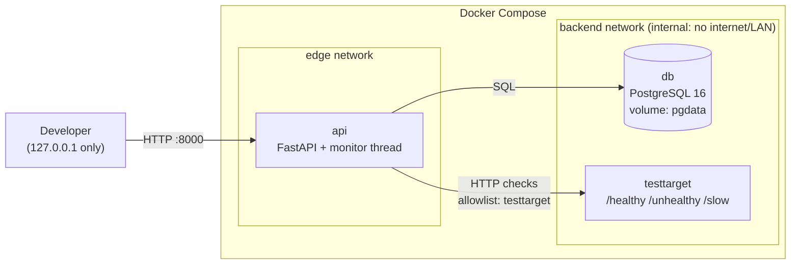

# InfraScope

Open-source infrastructure monitoring and incident detection. InfraScope checks HTTP(S)
endpoints on a schedule, stores every real measurement in PostgreSQL, and opens and
resolves incidents automatically.

> **Day 1 status: backend MVP.** No frontend yet. The API has **no authentication**. It is a
> localhost-only development API, and authentication/authorization are Day 2 requirements.
> See [docs/DAY1_PROGRESS.md](docs/DAY1_PROGRESS.md) for exactly what has been verified.

## Features (Day 1)

- Target management REST API (create, list, get, update, enable/disable, delete)
- Background HTTP monitor: real response times, status codes, timeouts and connection errors
- Incident detection: DOWN after 2 consecutive failures, resolved after 2 consecutive successes,
  no duplicate open incidents (enforced by a database index), history preserved
- PostgreSQL 16 with Alembic migrations, UUID keys, UTC timestamps
- SSRF protection: only allowlisted hostnames; no IPs, credentials or redirects
- Docker Compose stack: API, PostgreSQL and a local test-target service
- 120 pytest tests (115 unit + 5 integration against the real test-target service)



More detail: [docs/ARCHITECTURE.md](docs/ARCHITECTURE.md) · API reference: [docs/API.md](docs/API.md)
· Interactive docs: <http://127.0.0.1:8000/docs>

## Quick start (Windows PowerShell + Docker Desktop)

Prerequisites: Docker Desktop with the WSL 2 backend, and Git.
Verified on Windows 11 with Docker Desktop 4.96 (Engine 29.9.1).

```powershell
git clone <your-repo-url> infrascope
cd infrascope

# 1. Create your local env file and change POSTGRES_PASSWORD
#    (use letters, digits, - and _ only: it is embedded in a database URL)
Copy-Item .env.example .env
notepad .env

# 2. Start everything (single command)
docker compose up -d --build

# 3. Check health (all three services should be "healthy")
docker compose ps
Invoke-RestMethod http://127.0.0.1:8000/health
```

Register a target and watch it:

```powershell
$body = @{ name = "demo-healthy"; url = "http://testtarget:8080/healthy"; interval_seconds = 10 } | ConvertTo-Json
$t = Invoke-RestMethod -Method Post http://127.0.0.1:8000/api/v1/targets -ContentType application/json -Body $body
Start-Sleep 25
Invoke-RestMethod "http://127.0.0.1:8000/api/v1/targets/$($t.id)/results"
Invoke-RestMethod http://127.0.0.1:8000/api/v1/summary
```

Full outage → incident → recovery demo, plus a restart-persistence check:

```powershell
.\scripts\smoke-test.ps1 -VerifyRestart
```

Stop the stack (data is kept in the `pgdata` volume):

```powershell
docker compose down
```

`docker compose down -v` **deletes the database volume**. Only use it when you want to wipe all data.

## Running tests

Inside Docker (runs on PostgreSQL, in the separate `infrascope_test` database, and includes the
integration tests against the `testtarget` container):

```powershell
docker compose exec api pytest -v
docker compose exec api pytest -m integration -v   # integration tests only
```

Locally, without Docker (unit tests use SQLite temp files; integration tests are skipped):

```powershell
py -3.12 -m venv .venv
.\.venv\Scripts\Activate.ps1
python -m pip install -r requirements-dev.txt
python -m pytest
ruff check .
```

Integration tests locally, with the test target running on your machine:

```powershell
# terminal 1 (bind to ::1, see Troubleshooting for why)
cd testtarget; ..\.venv\Scripts\python.exe -m uvicorn app:app --host ::1 --port 8081
# terminal 2
$env:INFRASCOPE_TEST_TARGET_URL = "http://localhost:8081"
python -m pytest -m integration -v
```

## Running the API locally without Docker

Useful for debugging. Uses a local SQLite file, not PostgreSQL:

```powershell
$env:DATABASE_URL = "sqlite:///./local.db"
$env:ALLOWED_TARGET_HOSTS = "localhost"
alembic upgrade head
uvicorn app.main:create_app --factory --host 127.0.0.1 --port 8000
# with the test target from above running on :8081:
.\scripts\smoke-test.ps1 -TargetBase http://localhost:8081
```

## Configuration

| Variable | Default | Purpose |
|---|---|---|
| `DATABASE_URL` | *(required)* | SQLAlchemy URL; Compose builds it from `POSTGRES_*` |
| `ALLOWED_TARGET_HOSTS` | `testtarget` | Comma-separated hostnames the monitor may contact |
| `MONITOR_ENABLED` | `true` | Run the background monitor |
| `MONITOR_TICK_SECONDS` | `1` | How often the scheduler looks for due targets |
| `HTTP_TIMEOUT_SECONDS` | `5` | Per-check timeout |
| `FAILURE_THRESHOLD` | `2` | Consecutive failures before DOWN + incident |
| `RECOVERY_THRESHOLD` | `2` | Consecutive successes before an incident is resolved |
| `API_PORT` | `8000` | Host port (always bound to `127.0.0.1`) |
| `SLOW_DELAY_SECONDS` | `3` | Default delay of the test target's `/slow` |

## Security model (Day 1)

- Only the API port is published, and only on `127.0.0.1`. PostgreSQL and the test target have
  no host ports and sit on an `internal` Docker network with no outbound route.
- Monitored URLs must use `http`/`https` and an **allowlisted hostname**. IP literals
  (private, public, loopback, link-local/metadata), embedded credentials, whitespace,
  backslashes and control characters are rejected. The policy is checked at registration
  **and** before every check.
- Redirects are never followed; proxy environment variables are ignored.
- Secrets live only in `.env` (git-ignored); the database URL is a `SecretStr` and is never logged.
- **No authentication yet.** Do not deploy this API anywhere it is reachable by others.

## Troubleshooting

| Symptom | Fix |
|---|---|
| `docker : The term 'docker' is not recognized` | Install/start Docker Desktop, then open a **new** terminal (old ones keep the old PATH). |
| `failed to connect to the docker API at npipe:////./pipe/docker_engine` | Docker Desktop isn't running. Start it and wait for "Engine running". |
| `docker compose ps` shows `5432/tcp` but port 5432 answers on the host | That's another PostgreSQL on your machine, not InfraScope's. `docker port infrascope-db-1` should print nothing. |
| `required variable POSTGRES_PASSWORD is missing` | You skipped `Copy-Item .env.example .env`. |
| `api` stays `starting`/`unhealthy` | `docker compose logs api`; usually a DB password mismatch. If you changed `POSTGRES_PASSWORD` after the first start, the existing volume still has the old one. Restore it, or wipe with `docker compose down -v` (deletes data). |
| Port 8000 already in use | Set `API_PORT=8001` in `.env`, then `docker compose up -d`. |
| Target registration returns 422 `not in the monitoring allowlist` | Use `http://testtarget:8080/...`, or add the hostname to `ALLOWED_TARGET_HOSTS`. |
| `docker compose exec api pytest` fails with `database "infrascope_test" does not exist` | The init script only runs on a fresh volume: `docker compose exec db createdb -U infrascope infrascope_test` |
| Local checks of `http://localhost:...` take ~2 s | Windows tries `::1` first and waits ~2 s before falling back to IPv4. Bind the local server to `::1` (or use Docker, where service names resolve directly). |
| `Activate.ps1 cannot be loaded` | `Set-ExecutionPolicy -Scope CurrentUser RemoteSigned`, or run `.\.venv\Scripts\python.exe` directly. |

## Project layout

```
app/
  main.py              FastAPI factory + lifespan (starts/stops the monitor)
  config.py            Settings (env vars)
  db.py, models.py     SQLAlchemy engine/session and ORM models
  schemas.py           Pydantic request/response models
  api/                 Routers: health, targets, incidents, summary
  services/
    url_policy.py      SSRF allowlist validation
    checker.py         Real HTTP check (httpx)
    incidents.py       Incident rules (scheduler-independent)
    monitor.py         Background scheduler thread
migrations/            Alembic
testtarget/            Local test HTTP service (own image)
tests/                 Unit tests + tests/integration
scripts/smoke-test.ps1 End-to-end check incl. restart persistence
```

## License

[MIT](LICENSE)
