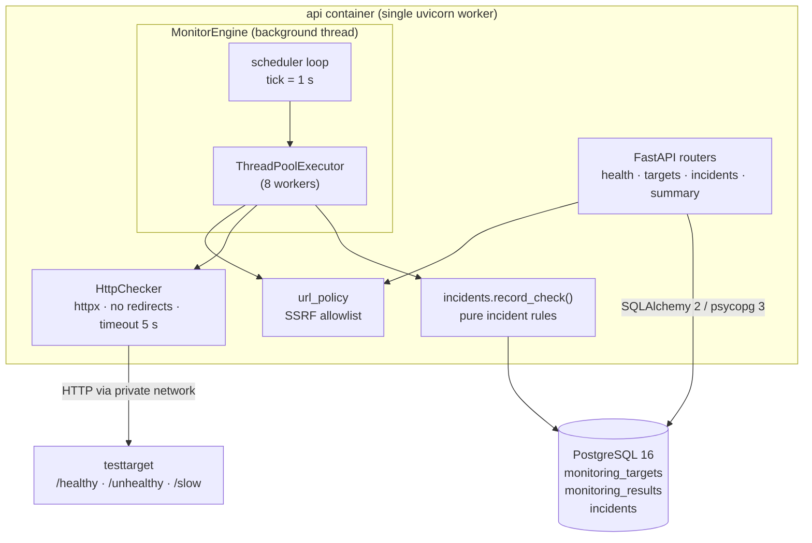
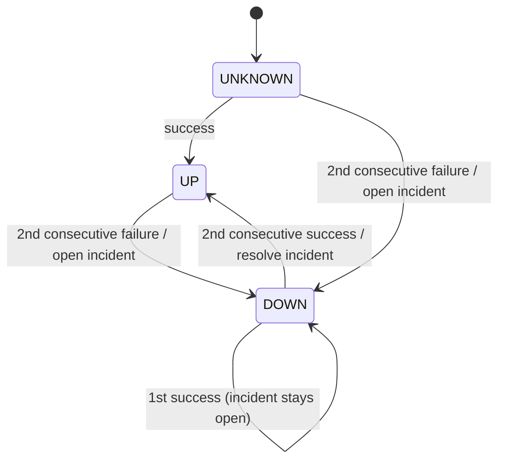
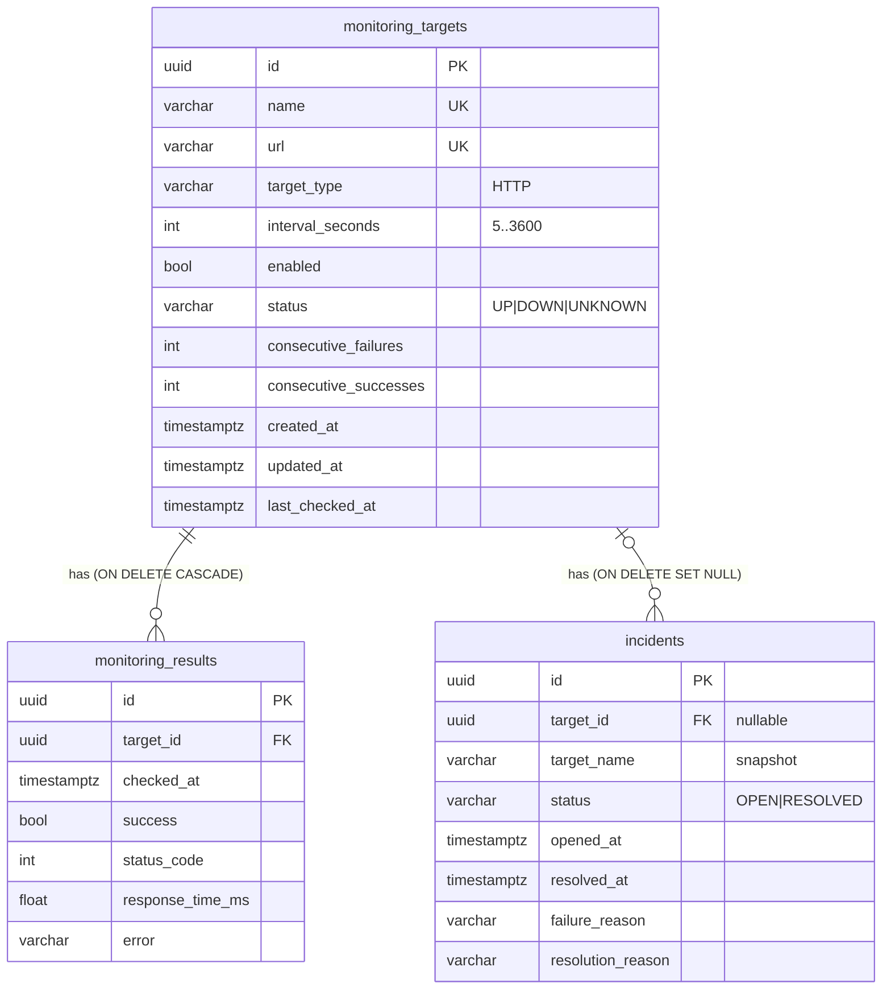

# InfraScope Architecture (Day 1)

## Components

### Request path
FastAPI endpoints are plain `def` functions, so FastAPI runs them in its threadpool with a
SQLAlchemy session per request (`app/api/deps.py`). Target URLs go through
`validate_target_url()` before they are stored.

### Monitoring path
1. `MonitorEngine` runs in its own daemon thread. It is started and stopped by the FastAPI
   lifespan, so it never blocks the event loop or API requests.
2. Every tick it loads enabled targets and selects those where
   `now - last_checked_at >= interval_seconds` (or that have never been checked).
3. Each due target is checked on the thread pool:
   - the URL policy is re-applied (an allowlist change takes effect immediately; blocked
     targets are recorded as failures without any network request);
   - `HttpChecker` does a streaming GET and measures time until response headers with
     `time.perf_counter()`. Bodies are never downloaded, redirects are never followed,
     keep-alive is disabled so each measurement includes connection setup, and proxy env vars
     are ignored;
   - the outcome is persisted in its own transaction with `SELECT … FOR UPDATE` on the target
     row. If the target was deleted, disabled or re-pointed mid-check, the result is discarded.
4. On shutdown, `stop()` sets an event, joins the scheduler thread and waits for in-flight
   checks (bounded by the HTTP timeout).

### Incident rules (`app/services/incidents.py`)

- A single failure never changes status (flap protection).
- An incident is only opened if none is open for that target. The partial unique index
  `uq_incidents_open_per_target (target_id) WHERE status = 'OPEN'` enforces this in the DB.
- `failure_reason` is the reason from the check that confirmed the outage (e.g. `HTTP 503`,
  `Timeout after 5s`, `Connection failed: …`).
- Thresholds are configurable (`FAILURE_THRESHOLD`, `RECOVERY_THRESHOLD`).
- `record_check()` takes a session, a target and an outcome. It has no scheduler or network
  dependency, so it is unit-tested directly.

## Data model

- Enums are stored as `VARCHAR` + `CHECK` (not native PG enums) to keep migrations simple.
- All timestamps are `timestamptz`. The `UTCDateTime` type rejects naive datetimes and always
  returns aware UTC values.
- Indexes: `(target_id, checked_at)` for result history, `checked_at` for the 24-hour summary,
  `(enabled, status)` on targets, `(status, opened_at)` and `target_id` on incidents.
- Deleting a target cascades its results, but **keeps its incidents**. `target_id` becomes
  NULL, `target_name` is a snapshot, and any open incident is resolved with
  `resolution_reason = "Target deleted"`.
- `tests/test_persistence.py` runs Alembic upgrade/downgrade and asserts there is no drift
  between the models and the migration.

## Security boundaries

| Boundary | Control |
|---|---|
| Host → API | Published on `127.0.0.1` only; no auth yet (Day 2) |
| Host → DB / testtarget | Not published at all |
| Containers → internet/LAN | `db` and `testtarget` are on an `internal: true` network |
| API → monitored URL (SSRF) | Hostname allowlist; no IP literals, userinfo, non-HTTP schemes, control chars; checked on write **and** before every request; redirects disabled; `trust_env=False` |
| Secrets | `.env` git-ignored; `DATABASE_URL` is a `SecretStr`; `httpx` request logging silenced |
| Containers | Non-root users in both images |

Residual risk: the allowlist trusts Docker's DNS for the allowlisted names. That is acceptable
for a private Compose network, but must be revisited before monitoring external hosts (Day 2+:
resolve-then-pin with IP range checks).

## Known limitations / design decisions

- **Single process.** The scheduler runs inside the API process (`--workers 1`). Several
  replicas would double-check targets. Scaling out needs a separate worker service with
  `SELECT … FOR UPDATE SKIP LOCKED` leasing or a distributed lock.
- Due-target selection loads all enabled targets each tick. Fine for hundreds of targets; for
  more, push the due filter into SQL.
- Results grow unbounded; retention/downsampling is future work.
- Only `HTTP` targets. TCP, ICMP, DNS and TLS-expiry checks are planned (`TargetType` enum).
